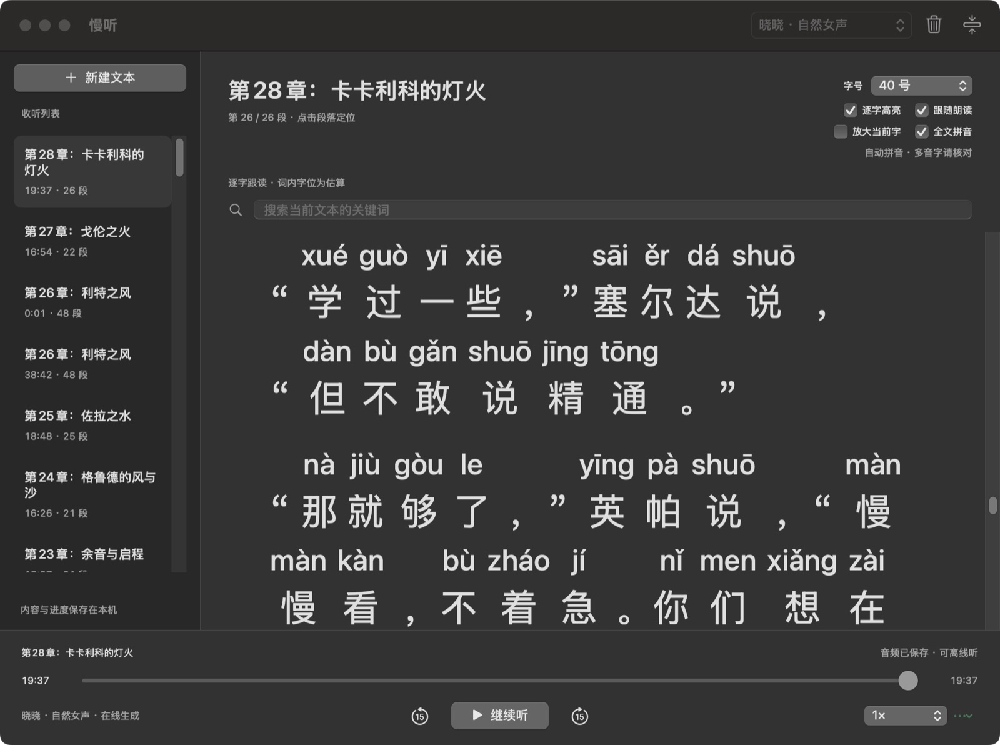
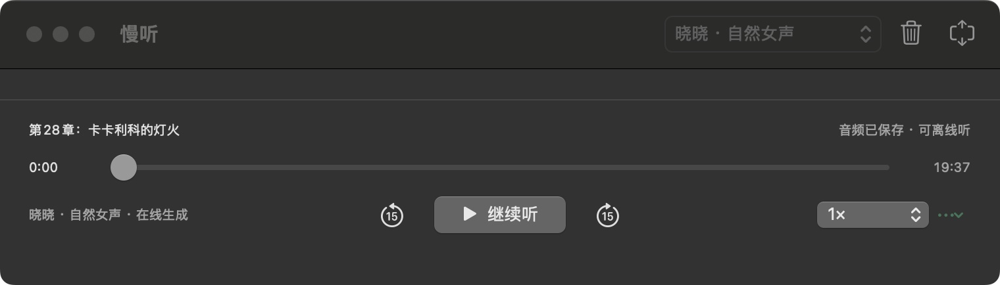
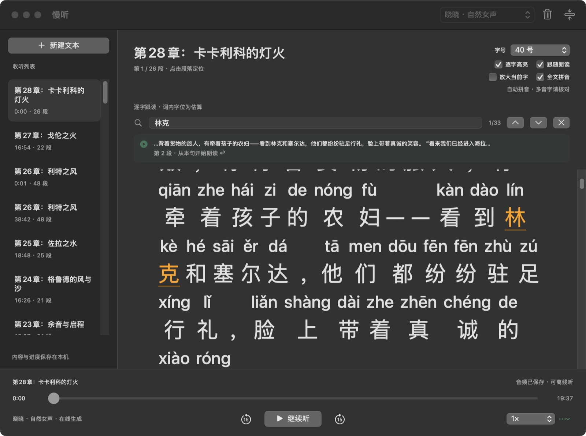

# 慢听

用于 macOS 的免费文本朗读 app。构建后把 `build/慢听.app` 复制到 `~/Applications/`；双击后粘贴文字，点“开始朗读”。无账号、API key、付费或依赖安装步骤。

- 晓晓 / 云希：免费在线中文神经语音，文字会发送给 Microsoft Edge 朗读服务。
- 婷婷：macOS 本机语音，不联网。
- 生成的音频保存在本机，支持暂停续播、拖动进度、前后 15 秒、段落跳转、倍速、每篇独立进度和迷你模式。

  

- 逐字高亮：当前单个字符显示黄色背景，暂停、倍速、拖动和重开后跟随播放器时间。可在正文右上角关闭。在线音色使用词级时间标记，本机音色使用合成时的字词回调及文件位置；多字词内逐字插值，本机锚点另有缓冲区误差，不能视为逐字精确时间戳。
- 正文字号：正文右上角选择 16～64 号，默认 32 号；选择自动保存。放大后文字重新换行，每屏显示更少内容；字号调整不改变音频和收听进度。
- 识字显示：默认开启“放大当前字”和“全文拼音”。当前高亮字按正文字号的两倍显示，带拼音；“全文拼音”会自动给新旧正文中的汉字标注带声调拼音。两个开关分别保存：关掉“全文拼音”后可只看当前字的拼音，全部关闭则恢复普通正文。拼音在本机用内置词库生成，不改变原文或音频；多音字、人名等仍可能标错，不能作为无误的读音标准。
- 旧音频会显示“逐字位置为估算”，不会自动重写缓存或改变进度。点“重新生成本篇，从本段开始”可补充字词时间信息：从当前段开头播放，正文与旧音频保留。
- 关键词定位：`⌘F` 搜索当前文本，高亮全部命中；用上下箭头或 `⌘G` / `⇧⌘G` 切换，按回车或点结果从命中词所在句的开头朗读。首次定位会只重新准备涉及的音频段，保留全文和其他缓存。

  
- 删除条目：右键收听列表中的条目，或点右上角废纸篓；确认后将正文、进度和缓存音频一起移到 macOS 废纸篓。删除其他条目不会中断当前播放。
- 长文边生成边播放。全部准备好以前总时长显示“约”；跳到未生成段落时从该段开头准备。
- 退出 app 会保存进度；关闭窗口继续后台播放。重新打开默认暂停，点“继续听”。Mac 休眠时自动暂停。

资料目录：`~/Library/Application Support/Manting`。包含正文、分段音频、阅读进度和上一版本备份。删除条目的废纸篓文件夹以文章 UUID 命名，`document.json` 保存原文和进度；尚不支持在 app 内一键恢复。请勿在播放期间手动移动资料目录。

在线服务采用 Edge 朗读兼容协议，当前实测可用；未来服务变更可能影响在线音色。连接失败时可在提示中切换“用本机语音”。没有付费接口或隐藏订阅。

此构建适配 Apple Silicon、macOS 14 及以上，在本机 macOS 15.7.9 验证。

2026-09-30 验证通过：正文分段完整性、原子保存/备份及写入中断恢复、真实音频播放/暂停/跨段跳转/倍速/每篇独立位置、缓存后续播、在线语音集成。安装后的 GUI 已实际生成并播放 52 秒中文示例，正常退出重开后恢复到 14.978 秒（第二段），迷你窗口收起与展开正常。

开发：`bash scripts/build.sh`。核心测试：`bash scripts/test-core.sh`。真实播放器测试：`bash scripts/test-playback.sh`，加 `--online` 检查在线语音集成。

1.1 新增验证：`bash scripts/test-search.sh` 覆盖关键词、跨段匹配、重叠高亮与 Unicode；`bash scripts/test-deletion.sh` 覆盖归档、删除失败与回滚。真实播放器测试已通过搜索句首播放及重开恢复、系统废纸篓归档、生成中删除、删除其他条目不中断播放和空列表状态。安装后的界面已验证重叠匹配数、切换结果及回车从命中句开始。

1.2 新增验证：`bash scripts/test-timeline.sh` 覆盖单字范围、词边界校准、暂停/跳转、emoji 和旧缓存标识；真实在线及本机语音测试已验证时间信息生成与保存、逐字位置随跳转改变和重开恢复。`MantingSpeechHelper` 随 app 内置，无额外安装；用于隔离本机语音合成和字词回调。

1.2.2 性能修复：恢复长文按需加载，播放时钟不再每秒 20 次刷新整篇正文；逐字背景直接更新原生绘制属性，正文高度按文本和宽度缓存，滚动仅在切段或定位时触发。进度条单独以每秒最多 4 次刷新，逐字高亮保留每 50 毫秒的时间采样。已用 61 段缓存长文验证持续播放、跨段、2 倍速、暂停及前进 15 秒；播放回归测试新增时钟与正文更新隔离检查并通过。此性能修复不改变时间标记精度，也不重新生成既有音频。

1.3 新增可保存的正文字号和大字号下的行内跟随；保留 1.2.2 的时钟隔离和正文高度缓存。已验证 16、32、64 号排版、播放中切换字号、64 号持续跨段播放、高亮滚动、暂停响应及退出重开后字号与位置保留；持续播放的 8 次 CPU 采样为 10.6%～23.8%。已更新安装，当前正文默认为 32 号，原收听条目与进度正常恢复。

1.4 新增本地自动拼音和两倍高亮字。字位与行高提前预留，逐字变化只更新绘制，避免每个字都引起换行；独立的 TextKit 测量缓存适配混排文本。搜索、重开及显示模式切换后定位到具体字，取消旧段落的延迟定位。`bash scripts/test-reading.sh` 已覆盖常见多音词、轻声、Unicode 原文映射、16/32/64 号下的四种组合、字与拼音边界以及高亮移动时排版不变；时间轴和搜索回归测试通过。隔离 GUI 验证了持续跨段播放、四种显示组合、32→64 号切换（高亮 64→128 号）、暂停、15 秒跳转、搜索命中字与切换结果、设置重开保存。32 号持续播放采样为 24.6%～51.9% CPU，64 号为 21.0%～33.5%；没有持续满载或界面停滞。

1.4 安装前后校验原有 340 个资料文件哈希一致，旧版应用保存在 `build/rollback/慢听-1.3.app`。隔离 GUI 验收可用 `MANTING_DATA_DIR` 指向测试副本，配合 `MANTING_MUTE_PLAYBACK=1` 静音测试；正式安装未设置这些环境变量。

1.4.1 增强拼音可见性：普通拼音由正文字号的 50% 增至 75%，使用中等字重和正文对比度；双倍高亮字的拼音由正文字号的 62% 增至 100%，使用半粗体。字位与行高随之预留。原有阅读排版测试通过，已在正式应用核对 64 号正文、48 号普通拼音及 64 号高亮拼音的显示；字号、开关和暂停进度保留，安装前后 340 个资料文件哈希一致。1.4 回退应用保存在 `build/rollback/慢听-1.4.app`。

1.4.2 在线语音修复：Edge 朗读服务把握手里的 `Sec-MS-GEC` 令牌由单段 SHA-256 改为 CS64 加摘要的两段式，并要求 `Sec-MS-GEC-Version` 使用 `2-` 前缀；旧令牌会让 WebSocket 握手被 HTTP 403 拒绝，与用量、IP 或账号无关。新增 `Sources/EdgeToken.swift`，按参考实现 `edge-tts` 的 `generate_sec_ms_gec_v2` 移植（该摘要是定制变体：前 7 个盐字节决定初始状态、第 14 轮使用调整常量、填充长度偏移 57 字节），握手改用新令牌与 `2-` 前缀，并移除已无用途的 CryptoKit 依赖。新增 `bash scripts/test-edge-token.sh`，用上游参考向量覆盖五分钟窗口滚动、令牌形状和加盐摘要。已用项目真实合成路径验证晓晓在线音色写出 23 KB 音频与逐字时间轴；1.4.1 回退应用保存在 `build/rollback/慢听-1.4.1.app`。

## 开源

- 许可证：MIT，见 `LICENSE`。
- 第三方组件与协议来源：见 `THIRD_PARTY_NOTICES.txt`（edge-tts 协议参考、pinyin-pro MIT）。
- 构建产物与编译缓存 `build/` 不入库；运行 `bash scripts/build.sh` 重新生成，产物为 `build/慢听.app`。
- 本项目与 Microsoft 无关联；在线音色会把所选文字发送到 Microsoft Edge 朗读服务，本机音色不联网。
